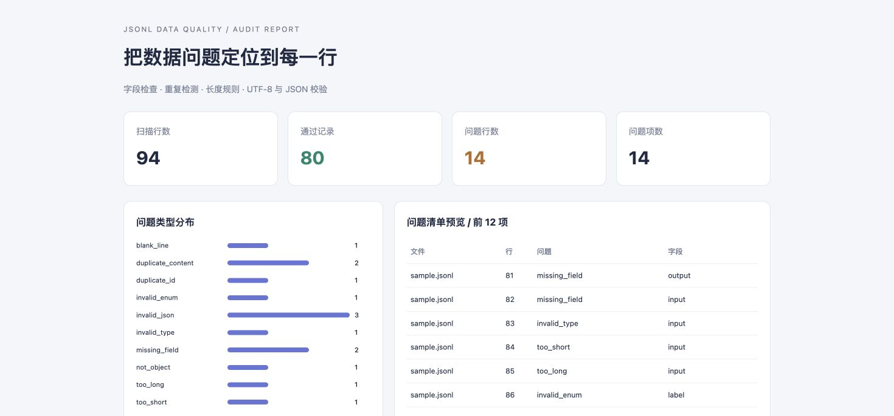

# JSONL 数据质检脚本

读取 JSONL 数据集，按可配置规则检查字段缺失、类型错误、重复记录和长度异常，输出带文件名与行号的 CSV 问题清单，以及 JSON、Markdown 和离线 HTML 汇总。

这是使用**模拟数据**的个人项目，创建于 2026-10。适合展示 Python 数据处理、数据标注质检和批处理能力，不代表实际雇佣经历。



## 一条命令运行

Python 3.11+，核心运行只使用标准库，无需安装 pandas 或数据库服务。

```bash
git clone https://github.com/william202201/jsonl-data-quality.git
cd jsonl-data-quality
python -m jsonl_quality --input examples/sample.jsonl --output outputs/demo
```

打开 `outputs/demo/report.html` 查看结果，或用 Excel 打开 `issues.csv`。仓库的 [`examples/output`](examples/output) 已保存一份可下载结果。

示例共 94 个物理行，80 行通过，14 个问题行。故意植入缺字段、空值、类型错误、过短/过长、非法标签、主键重复、规范化内容重复、非法 JSON、非对象和空行。所有内容均为虚构。

## 自有数据与自动化

```bash
# 多文件检测，重复索引跨文件共享
python -m jsonl_quality --input batch_a.jsonl batch_b.jsonl --output outputs/check

# 使用自定义字段规则，发现问题时返回非零退出码
python -m jsonl_quality --input my_data.jsonl --rules my_rules.json --fail-on-issues

# 可选安装控制台命令
python -m pip install -e .
jsonl-quality --input examples/sample.jsonl

# 运行测试
python -m unittest discover -s tests -v
```

| 退出码 | 含义 |
| --- | --- |
| `0` | 扫描完成。默认模式下即使有数据问题也返回 0 |
| `1` | 扫描完成且有问题，仅在 `--fail-on-issues` 时使用 |
| `2` | 输入、配置或运行错误，请检查 stderr |

原始文件不修改、不删除，不自动修复。每次输出先在临时目录生成，再逐文件替换，`summary.json` 最后写入；输出不是跨文件事务。运行失败时旧输出可能仍在，务必检查退出码。

## 输出内容

| 文件 | 用途 |
| --- | --- |
| `issues.csv` | 一条问题项一行：file、line、code、field、message、first_file、first_line |
| `summary.json` | 机器可读计数、逐文件统计、规则快照和长度单位 |
| `summary.md` | 可放进交付文档的简短汇总 |
| `report.html` | 无 CDN、无外部脚本的离线问题预览 |

报告只输出定位信息与问题原因，不复制原始问答正文。存在同名文件时使用 `input1:文件名` 等标签区分，不输出绝对路径。CSV 对危险公式前缀转义，HTML 对动态文本转义。

## 规则示例

默认规则位于 [`jsonl_quality/default_rules.json`](jsonl_quality/default_rules.json)。可以复制后修改：

```json
{
  "fields": {
    "id": {"type": "string", "required": true},
    "prompt": {"type": "string", "required": true, "min_length": 5, "max_length": 2000},
    "response": {"type": "string", "required": true, "min_length": 5, "max_length": 4000},
    "meta.source": {"type": "string", "required": false}
  },
  "duplicate_key_fields": ["id"],
  "content_fields": ["prompt", "response"],
  "normalize_content": true
}
```

- 支持 `string`、`integer`、`number`、`boolean`、`array`、`object`；布尔值不能冒充整数。
- 字段路径支持点号访问嵌套对象，不支持数组下标及字段名含字面点号的情况。
- 必填值缺失、null 或纯空白字符串视为缺失。可选字段允许不存在；存在时也必须满足类型、枚举与长度规则，null/空白会报错。
- `min_length` / `max_length` 用于字符串或数组。字符串按 Python `len` 计算 Unicode code point，包含原始空格；数组按元素数计数。不是 token、字节或用户感知字素数。
- `enum` 用于标签白名单。未配置的额外字段允许存在。未知配置项会报错，避免拼写错误被静默忽略。
- `duplicate_key_fields` 可以组成复合业务键。只对字段存在且类型正确的记录建索引。
- `content_fields` 指定用于判断内容重复的字段；默认做 NFKC、连续空白折叠与大小写折叠。关闭 `normalize_content` 后使用原始值。长度检查始终使用原始字段。

## 问题代码与计数口径

| 代码 | 含义 |
| --- | --- |
| `missing_field` | 必填值不存在、null 或空白 |
| `invalid_type` | 字段类型不符或可选字段的空值 |
| `too_short` / `too_long` | 字符或数组长度超出阈值 |
| `invalid_enum` | 标签不在配置白名单中 |
| `duplicate_id` | 业务键已出现 |
| `duplicate_content` | 所选内容字段相同或规范化后相同 |
| `invalid_json` | JSON 语法错误、重复对象键、非有限数或过深嵌套 |
| `invalid_utf8` | 行无法以 UTF-8 解码 |
| `not_object` | JSON 顶层不是对象 |
| `blank_line` | 空物理行 |
| `line_too_large` | 物理行超过最大字节数 |

一行可能有多个问题，因此**问题项数不等于问题行数**。重复只标记后出现的记录并关联第一条，第一条可能仍被计为通过；通过表示未命中当前规则，不证明语义正确。主键重复与内容重复可能同时命中。

行数满足：

```text
total_lines = parsed_records + invalid_lines
total_lines = clean_records + problem_lines
total_issues = CSV 中除表头外的行数
```

`parsed_records` 仅计成功解析的 JSON 对象。空行、非法 UTF-8、非对象 JSON、重复 JSON 键及非法数都归入 `invalid_lines`。接受首行 UTF-8 BOM 和末行无换行符，Windows CRLF 同样支持。

## 实现与边界

```text
JSONL 物理行 → 有界字节读取 → 严格 JSON 对象解析
                                ↓
                      字段/类型/长度/枚举校验
                                ↓
                 SQLite + SHA-256 主键/内容重复索引
                                ↓
                 CSV 逐项写出 → JSON / Markdown / HTML
```

默认每行最多 4 MiB（含换行），可用 `--max-line-bytes` 修改。超长行会分块跳过，下一行继续检测。重复指纹写入临时 SQLite，避免把全部数据或指纹集合放进 Python 内存；磁盘占用随唯一记录数增长。报告预览只保留前 12 个问题项。SHA-256 存在理论碰撞概率，未对超大数据集做规模性能承诺。

结构检查不评判答案真实性、语义一致性、版权或训练价值，不做近似语义去重。输入文件的读取顺序决定重复的“首条”归属。

本地 16 项测试覆盖正常输入、跨文件重复、Unicode 长度边界、损坏行继续扫描、有界超长行、空文件、嵌套字段、配置错误、退出码及 CSV 转义。GitHub Actions 在 Python 3.11/3.13 运行测试与示例，并上传结果。

简历表述和面试演示见 [`docs/interview.md`](docs/interview.md)。MIT License.
